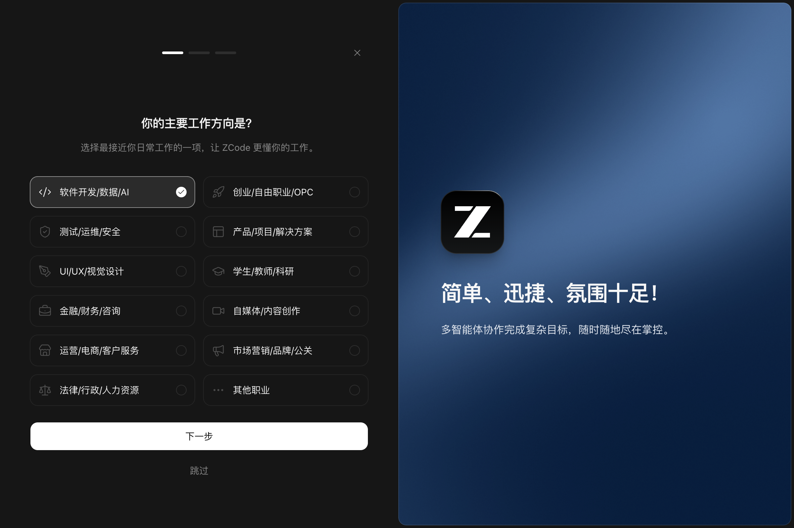
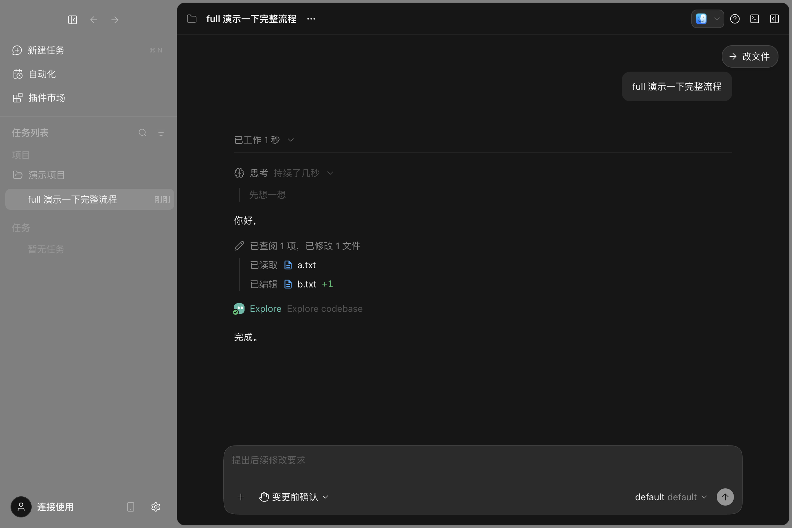
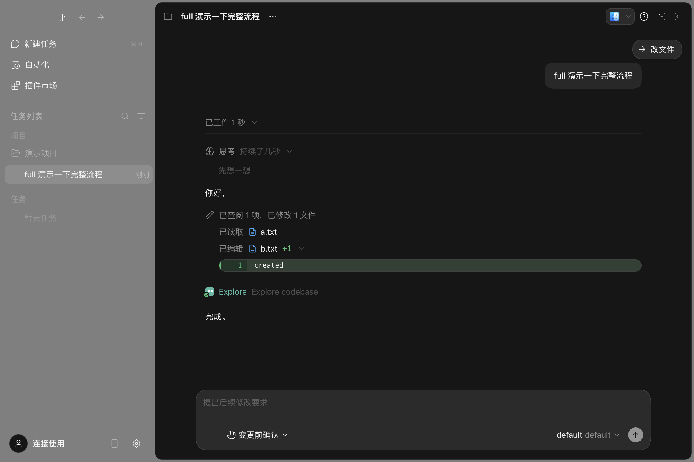
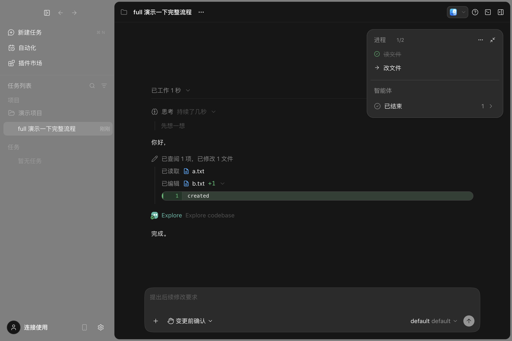
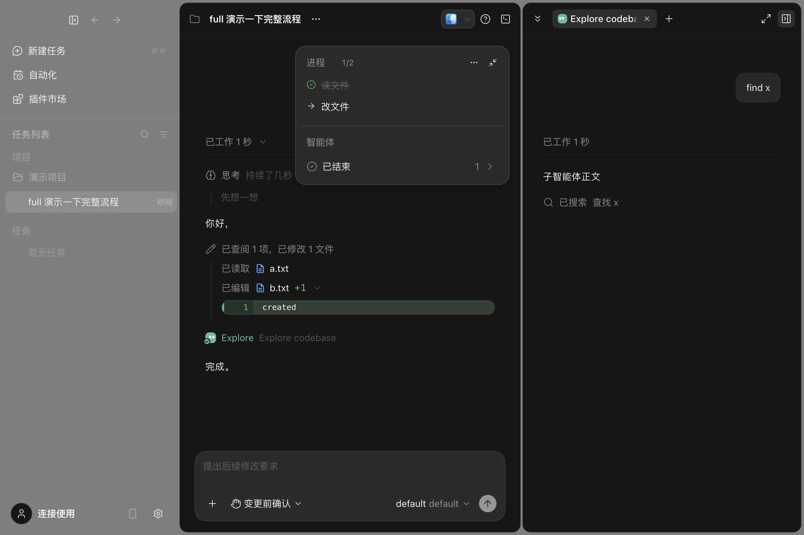
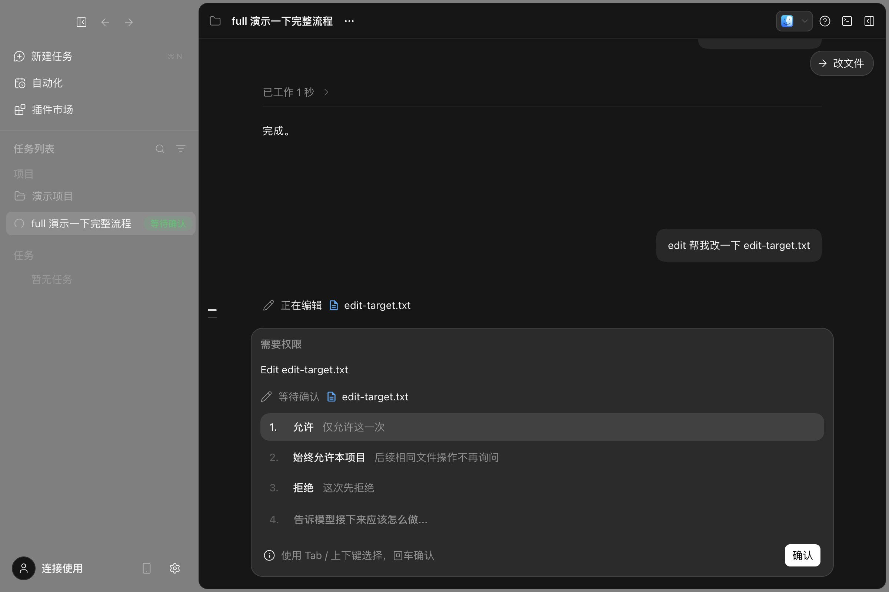
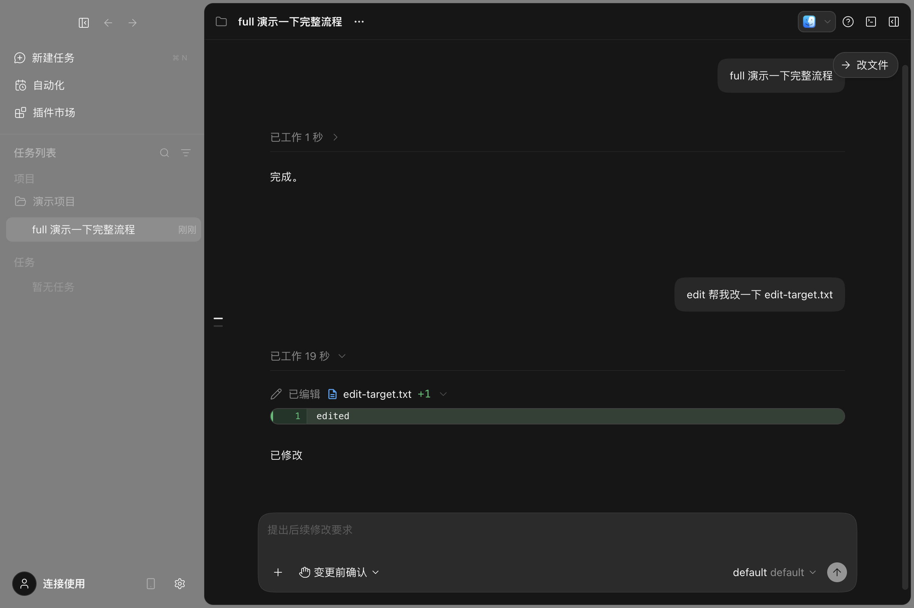
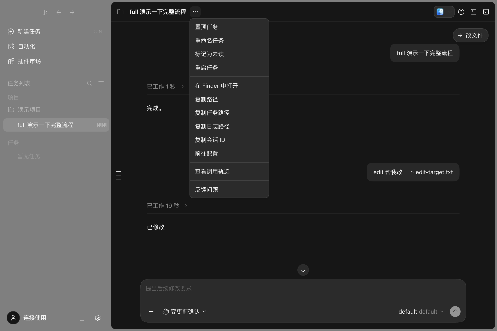

# 把自己的 Claude Code 接进桌面客户端：图文步骤

这份教程带你走一遍：装好客户端后，不用登录任何账号，直接用你电脑上已有的 Claude Code（或别的支持 ACP 协议的智能体）在桌面客户端里干活。

> 下面的截图是用「模拟版 Claude Code」拍的（名字叫「Claude Code（模拟）」），它不连任何真实模型，只按固定剧本回话，所以截图里的回复内容是演示用的。换成你自己的 Claude Code 后，界面完全一样，只是回复变成真的。

---

## 第 0 步：告诉客户端你的智能体在哪

在数据目录下新建一个文件 `.zcode/acp-agents.json`（默认就是你用户目录下的 `.zcode` 文件夹），写上你的智能体怎么启动：

```json
{
  "agents": [
    {
      "id": "claude",
      "name": "Claude Code",
      "command": "/path/to/your/claude-acp-launcher",
      "args": [],
      "models": ["default", "opus", "sonnet"]
    }
  ]
}
```

- `name` 就是模型选择器里显示的分组名。
- `models` 是你想在下拉框里看到的模型，`default` 表示「用智能体自己的默认模型」。
- 有好几个账号就写好几条，`id` 不一样就行。
- 改完配置，把客户端完全退出再打开。

---

## 第 1 步：打开客户端，不用登录

第一次打开会先问你几个偏好问题（工作方向、界面模式、助手偏好），每页右下都可以点「跳过」。



跳过之后直接进主界面——**不会**被拦在「登录」页，也**没有**「当前没有可用模型」的提示条。


---

## 第 2 步：选项目、选模型

1. 点输入框上方的「选择项目」→「创建项目」→「选择文件夹」，挑你要让智能体干活的文件夹，起个名字，点「创建项目」，再确认「信任文件夹并创建」。
2. 点输入框右下角的模型名，下拉框里能看到你在配置里写的分组（这里是「Claude Code（模拟）」），下面列着它的模型，选一个。


---

## 第 3 步：发一条消息，看它干活

在输入框里说你要干什么，回车发送。回复区会依次出现：

- **思考**：智能体在想什么（可以折叠）。
- **正文**：它对你说的话。
- **工具卡片**：它读了哪些文件、改了哪些文件。「已查阅 1 项，已修改 1 文件」这一行可以展开。



点改过的文件名，能直接看到改了哪几行（绿色是新增的内容）。



---

## 第 4 步：看计划进度和子智能体

如果智能体给自己列了计划，右上角会出现一个小胶囊（这里显示「→ 改文件」），点开能看到整份计划：做完的打勾划掉，正在做的有箭头。下面的「智能体」一栏显示它派出去的帮手有几个、是否已结束。



回复里绿色小机器人图标那一行（这里是「Explore」）就是子智能体。点它，右边会打开一个侧栏，显示这个子智能体收到的任务（「find x」）和它自己的回复、搜索记录。



---

## 第 5 步：改文件前先问你

输入框左下的「变更前确认」打开时，智能体每次要改文件都会先停下来问你：



- **允许**：只这一次放行。
- **始终允许本项目**：以后这个项目里同一个文件的同类操作不再问。
- **拒绝**：这次不让改。
- **告诉模型接下来应该怎么做**：不放行，同时给它新指示。

选「允许」并点「确认」后，文件真的被改了，卡片显示改动内容：



---

## 第 6 步：随时叫停

智能体在跑的时候，发送按钮会变成一个方块（停止）。


点一下，这一轮马上停下，回复上方会标「已停止」，已经输出的内容保留。


---

## 和内置模型会话的区别

用你自己的智能体时，有几样功能由智能体自己管，客户端不去插手，所以按钮不出现：

- 鼠标移到你发的消息上，只有「复制」按钮，**没有**「从这里回退」「分叉」之类的按钮。
- 标题旁的「⋯」菜单里也**没有**分叉、压缩上下文这类选项。




---

## 常见问题

- **下拉框里看不到我的智能体？** 检查 `acp-agents.json` 的位置和 JSON 格式，`command` 要写绝对路径；改完要完全退出客户端再打开。
- **智能体启动后找不到它自己的配置？** 在那一条里加 `"env": { ... }`，把它需要的配置目录写成绝对路径。
- **需要登录客户端账号吗？** 不需要。用自己的智能体时，客户端账号可以一直不登录。
